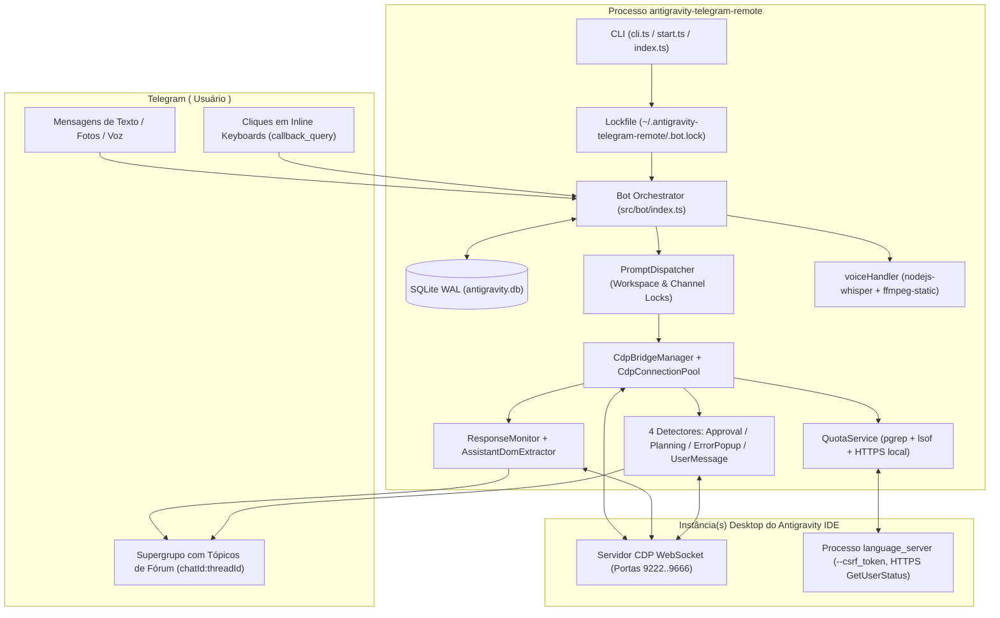

# 01 — Engenharia Reversa e Visão Geral do Sistema

## 1. Propósito do Sistema

O **`antigravity-telegram-remote`** é uma ponte de controle remoto bidirecional entre o **Telegram** (via Bot API e Supergrupos com Tópicos de Fórum) e o IDE **Antigravity** (fork do VS Code/Cursor baseado em Electron/Chromium).

Ao contrário de bots que apenas consomem APIs REST de LLMs, o `antigravity-telegram-remote` **controla diretamente a instância gráfica do IDE Antigravity em execução na máquina do usuário** utilizando o **Chrome DevTools Protocol (CDP)** sobre WebSocket local (`127.0.0.1`) e consulta o servidor gRPC/Connect local (`language_server`) para telemetria de cotas de modelos.

Isso permite que o usuário, pelo celular ou desktop no Telegram:
1. Liste e abra projetos (workspaces) locais em janelas dedicadas do Antigravity (`--remote-debugging-port=<port>`), vinculando cada projeto ou sessão a um Tópico de Fórum do Telegram (`<chatId>:<threadId>`).
2. Envie prompts de texto, fotos (anexadas via `DOM.setFileInputFiles` no `<input type="file">` do painel lateral ou como URLs de fallback) e mensagens de voz (transcritas localmente via `nodejs-whisper` / `whisper.cpp` + `ffmpeg-static`).
3. Acompanhe em tempo real o raciocínio (`<blockquote expandable>`), logs de ferramentas (`ProcessLogBuffer`), tempo decorrido (`⏱️ Xs` a cada `5000ms`) e a resposta final formatada em HTML compatível com o Telegram, além de imagens geradas pelo assistente extraídas do DOM.
4. Receba notificações proativas com botões inline para **aprovar/negar execução de ferramentas** (`ApprovalDetector`: `Allow`, `Allow Chat`, `Deny` ou auto-accept), **visualizar/paginar/editar/aprovar planos** (`PlanningDetector` + `planUi.ts`) e **dispensar/copiar debug/tentar novamente em popups de erro** (`ErrorPopupDetector`).
5. Espelhe automaticamente no Telegram mensagens enviadas diretamente pelo teclado do PC na interface do Antigravity (`UserMessageDetector` + `ResponseMonitor.startPassive()`).
6. Alterne modos de execução (`fast` / `plan`) e modelos LLM diretamente na UI do Antigravity, consulte cotas e tempos de reset por modelo (`QuotaService`), gerencie templates de prompt e agende tarefas recorrentes via Cron (`ScheduleService`).

---

## 2. Inventário Completo do Código-Fonte Original (`src/` — 68 Arquivos, 13.876 Linhas)

Abaixo está o inventário completo, auditado linha por linha, de **todos os 68 arquivos reais** presentes em `src/`:

### 2.1. Entrypoint Direto (`src/` — 1 arquivo)
| Arquivo | Linhas | Responsabilidade Exata no Código Original |
| :--- | :---: | :--- |
| `src/index.ts` | 11 | Entrypoint direto de desenvolvimento/execução (`npm start`): imprime `LOGO`, adquire o lock em `~/.antigravity-telegram-remote/.bot.lock` via `acquireLock()` e chama `startBot().catch(logger.error)`. |

### 2.2. CLI e Comandos de Terminal (`src/bin/` — 6 arquivos)
| Arquivo | Linhas | Responsabilidade Exata no Código Original |
| :--- | :---: | :--- |
| `src/bin/cli.ts` | 54 | Entrypoint do binário CLI (`#!/usr/bin/env node`) usando `commander`. Define flags `--verbose` e `--quiet` e os subcomandos `start`, `doctor`, `setup` e `open`. Se invocado sem subcomando: caso não exista `~/.antigravity-telegram-remote/config.json` nem `.env` no `process.cwd()`, chama `printWelcome()` e `setupAction()`; caso contrário, executa `startAction()`. |
| `src/bin/welcome.ts` | 53 | Exporta `printWelcome()`, que exibe um box ASCII de 50 colunas com ícone de coruja, lista de comandos rápidos (`setup`, `open`, `start`, `doctor`) e link do repositório GitHub na primeira execução. |
| `src/bin/commands/start.ts` | 42 | Resolve o nível de log da CLI (`--verbose` $\rightarrow$ `debug`, `--quiet` $\rightarrow$ `error`), imprime `LOGO`, chama `acquireLock()`, dispara `checkForUpdates(version)` em background (fire-and-forget) e inicia `startBot(cliLevel)`. |
| `src/bin/commands/setup.ts` | 281 | Wizard interativo em 3 passos (`readline`): (1) `TELEGRAM_BOT_TOKEN` com leitura mascarada por `*` (`askSecret`) e validação online via `https://api.telegram.org/bot<token>/getMe` (timeout 10s; se a validação online falhar, exibe aviso e aceita o token informado); (2) `ALLOWED_USER_IDS` numéricos separados por vírgula; (3) `WORKSPACE_BASE_DIR` (padrão `~/Code`) com autocompletar de diretórios via tecla `Tab` (`directoryCompleter`) e criação opcional do diretório. Salva em `~/.antigravity-telegram-remote/config.json`. |
| `src/bin/commands/open.ts` | 157 | Procura a primeira porta TCP livre em `CDP_PORTS` (`9222, 9223, 9333, 9444, 9555, 9666`) tentando fazer bind local (`net.createServer().listen(port, '127.0.0.1')`) e inicia o aplicativo Antigravity com `--remote-debugging-port=<port>` conforme o SO (`open -a Antigravity --args ...` no macOS ou `spawn` detached com `ANTIGRAVITY_PATH`/binário padrão). |
| `src/bin/commands/doctor.ts` | 178 | Diagnóstico de ambiente em 7 etapas: (1) diretório `~/.antigravity-telegram-remote`; (2) arquivo `config.json`; (3) arquivo `.env` local; (4) presença de `TELEGRAM_BOT_TOKEN` e `ALLOWED_USER_IDS` (em `.env` ou `config.json`); (5) versão do Node.js `>= 18`; (6) verificações específicas de macOS (`platform === 'darwin'`): `xcode-select -p` e existência de `/Applications/Antigravity.app` ou `ANTIGRAVITY_PATH`; (7) varredura HTTP (`http://127.0.0.1:<port>/json/list`, timeout 2s) em todas as `CDP_PORTS`. Define `process.exitCode = 1` se alguma verificação crítica falhar. |

### 2.3. Bot Principal (`src/bot/` — 1 arquivo)
| Arquivo | Linhas | Responsabilidade Exata no Código Original |
| :--- | :---: | :--- |
| `src/bot/index.ts` | 1938 | Orquestrador central do bot Telegram usando `grammy`. Contém `sendPromptToAntigravity` (fluxo completo de injeção de prompt/imagens, monitoramento em streaming, timer de 5s, envio de `<blockquote expandable>` de thinking, extração de imagens geradas, renomeação automática de tópico e detecção de erro de cota) e `startBot` (inicialização do SQLite em modo WAL, `ensureAntigravityRunning()`, listeners de desconexão/reconexão do pool CDP, middleware de autenticação, registro dos 16 comandos `bot.command(...)`, menu `setMyCommands` com 15 comandos, roteador `callback_query:data`, handler `message:text`, handler `message:photo` e handler `message:voice`). |

### 2.4. Handlers Auxiliares de Comandos (`src/commands/` — 6 arquivos)
| Arquivo | Linhas | Responsabilidade Exata no Código Original |
| :--- | :---: | :--- |
| `src/commands/chatCommandHandler.ts` | 40 | Classe utilitária `ChatCommandHandler` que encapsula referências a `ChatSessionService`, `ChatSessionRepository`, `WorkspaceBindingRepository`, `WorkspaceService` e `CdpConnectionPool`. |
| `src/commands/cleanupCommandHandler.ts` | 53 | Define as constantes de callback `CLEANUP_ARCHIVE_BTN = 'cleanup_archive'`, `CLEANUP_DELETE_BTN = 'cleanup_delete'`, `CLEANUP_CANCEL_BTN = 'cleanup_cancel'` e implementa `CleanupCommandHandler` (`cleanupByChannelId` e `findInactiveSessions(guildId, days)` comparando `session?.createdAt ?? binding.createdAt` com a data de corte ISO). |
| `src/commands/joinCommandHandler.ts` | 36 | Classe utilitária `JoinCommandHandler` com o método `resolveProjectPath(projectName)` delegando para `WorkspaceService.getWorkspacePath`. |
| `src/commands/messageParser.ts` | 37 | Exporta `parseMessageContent(content)` que identifica mensagens iniciadas por `/` e extrai `commandName` e `args` preservando segmentos entre aspas duplas (`"..."`) como um único token. |
| `src/commands/slashCommandHandler.ts` | 123 | Implementa `SlashCommandHandler` para o comando textual `/template`: sem argumentos lista os templates; `/template add "name" "prompt"` cria um template; `/template delete "name"` remove pelo nome; `/template <name>` busca o template e retorna `{ success: true, message, prompt }` para disparo imediato. |
| `src/commands/workspaceCommandHandler.ts` | 32 | Reexporta `PROJECT_SELECT_ID` e `WORKSPACE_SELECT_ID` de `projectListUi.ts` e implementa `WorkspaceCommandHandler.getWorkspaceForChannel(channelId)`. |

### 2.5. Repositórios SQLite (`src/database/` — 4 arquivos)
| Arquivo | Linhas | Responsabilidade Exata no Código Original |
| :--- | :---: | :--- |
| `src/database/chatSessionRepository.ts` | 164 | Persistência da tabela `chat_sessions` (`id`, `channel_id UNIQUE`, `category_id`, `workspace_path`, `session_number`, `display_name`, `is_renamed`, `guild_id`, `created_at`). Métodos: `create`, `findByChannelId`, `findByCategoryId`, `getNextSessionNumber(categoryId)`, `updateDisplayName`, `findByDisplayName`, `deleteByChannelId`. |
| `src/database/scheduleRepository.ts` | 169 | Persistência da tabela `schedules` (`id`, `cron_expression`, `prompt`, `workspace_path`, `enabled`, `created_at`). Métodos: `create`, `findAll`, `findById`, `findEnabled`, `delete`, `update`. |
| `src/database/templateRepository.ts` | 131 | Persistência da tabela `templates` (`id`, `name UNIQUE`, `prompt`, `created_at`). Métodos: `create`, `findAll`, `findById`, `findByName`, `deleteByName`, `updateByName`. |
| `src/database/workspaceBindingRepository.ts` | 137 | Persistência da tabela `workspace_bindings` (`id`, `channel_id UNIQUE`, `workspace_path`, `guild_id`, `created_at`). Métodos: `create`, `findByChannelId`, `findByWorkspacePathAndGuildId`, `findByGuildId`, `findAll`, `deleteByChannelId`, `upsert`. |

### 2.6. Middlewares (`src/middleware/` — 2 arquivos)
| Arquivo | Linhas | Responsabilidade Exata no Código Original |
| :--- | :---: | :--- |
| `src/middleware/auth.ts` | 9 | Função `withAuth(userId, allowedUserIds, next)` mantida por compatibilidade com testes (a autenticação ativa do bot reside no middleware `bot.use` em `src/bot/index.ts`). |
| `src/middleware/sanitize.ts` | 34 | Exporta `resolveSafePath(inputPath, baseDir)`, que valida caminhos relativos contra path traversal (`..`) usando `path.resolve`/`path.relative` e resolve symlinks via `fs.realpathSync` para impedir symlink bypass fora de `WORKSPACE_BASE_DIR`. |

### 2.7. Serviços Core, CDP e Detectores (`src/services/` — 24 arquivos)
| Arquivo | Linhas | Responsabilidade Exata no Código Original |
| :--- | :---: | :--- |
| `src/services/antigravityLauncher.ts` | 60 | Exporta `ensureAntigravityRunning()`: verifica em paralelo todas as `CDP_PORTS` via HTTP GET `http://127.0.0.1:<port>/json/list` (timeout 2s). Se nenhuma responder, imprime um banner de aviso de 70 colunas com instruções de execução (`antigravity-telegram-remote open` ou comando manual). |
| `src/services/approvalDetector.ts` | 428 | Detector em background (`pollIntervalMs = 1500` padrão, configurado com `2000` no bridge) que inspeciona o DOM por diálogos de aprovação de comandos/edições (`Allow`, `Allow This Conversation` / `Always Allow`, `Deny`), deduplica por `approveText::denyText::description`, aciona cliques via CDP e notifica `onApprovalRequired` e `onResolved`. |
| `src/services/assistantDomExtractor.ts` | 444 | Constrói os scripts IIFE (`classifyAssistantSegmentsPayloadScript` e `extractAssistantSegmentsPayloadScript`) que percorrem o último turno do assistente em `.antigravity-agent-side-panel`, classificando os nós DOM em segmentos `activity`, `thinking`, `body`, `tool-call`, `tool-result` e `feedback`, além de converter o corpo em Markdown/HTML preservando blocos `<pre><code>` e links. |
| `src/services/autoAcceptService.ts` | 94 | Gerencia a flag em memória `enabled` para auto-aprovação de diálogos (`handle('on' | 'off' | 'status')`, aceitando aliases `enable/true/1`, `disable/false/0`, `status/state/show`). |
| `src/services/cdpBridgeManager.ts` | 439 | Mantém o estado compartilhado `CdpBridge` (pool CDP, `QuotaService`, `AutoAcceptService`, mapas de roteamento `approvalChannelByWorkspace` e `approvalChannelBySession`), constrói/parseia `callback_data` de aprovação/planejamento/erros e inicializa os 4 detectores por workspace (`ensureApprovalDetector`, `ensurePlanningDetector`, `ensureErrorPopupDetector`, `ensureUserMessageDetector`). |
| `src/services/cdpConnectionPool.ts` | 283 | Pool de conexões `CdpService` indexadas por nome de projeto (`extractProjectName`). Gerencia lock de conexão concorrente (`connectingPromises`), registro dos 4 detectores por workspace e propagação dos eventos `workspace:disconnected`, `workspace:reconnected` e `workspace:reconnectFailed`. |
| `src/services/cdpService.ts` | 1712 | Cliente WebSocket JSON-RPC para o Chrome DevTools Protocol: descoberta de alvos Workbench, abertura automática de janela para um workspace (`launchAndConnectWorkspace` usando `findAvailableCdpPort()`), rastreamento de contextos de execução V8 (`Runtime.executionContextCreated`/`Destroyed`/`Cleared`), reconexão exponencial ($3000 \times 2^{\text{attempt}-1}\text{ ms}$), injeção de mensagens (`injectMessage`) e imagens (`attachImageFiles` via token `data-agclaw-upload-token` + `DOM.setFileInputFiles`), leitura/troca de modo (`fast`/`plan`) e modelo LLM na UI, e extração de imagens geradas (`extractLatestResponseImages`). |
| `src/services/chatSessionService.ts` | 820 | Operações de sessão de chat na UI do Antigravity via CDP: `startNewChat` (clique via `Input.dispatchMouseEvent` no botão `[data-tooltip-id="new-conversation-tooltip"]` com verificação de transição de cursor `'pointer'` $\rightarrow$ `'not-allowed'`), `getCurrentSessionInfo`, `listAllSessions` (abre "Past Conversations", filtra sessões do workspace atual acima de `"Other Conversations"`, clica em `"Show N more..."` até 20 itens e fecha com `Escape`) e `activateSessionByTitle` (loop de retry de até 30s a cada 800ms via clique lateral ou busca em Past Conversations). |
| `src/services/errorPopupDetector.ts` | 303 | Detector em background (`pollIntervalMs = 3000`, `COOLDOWN_MS = 10000`) para modais/alertas de erro (`Agent terminated due to error`, `[ role="dialog" ]`, `[ role="alert" ]`). Suporta ações `clickDismissButton()`, `clickCopyDebugInfoButton()` + `readClipboard()` (`navigator.clipboard.readText()`) e `clickRetryButton()`. |
| `src/services/modeService.ts` | 94 | Gerencia os modos de execução `AVAILABLE_MODES = ['fast', 'plan']` (`DEFAULT_MODE = 'fast'`), mapeamentos de exibição (`⚡ Fast`, `📋 Plan`) e nomes internos da UI do Antigravity (`Fast`, `Planning`). |
| `src/services/modelService.ts` | 78 | Mantém a lista estática de referência `AVAILABLE_MODELS` (`gemini-3.1-pro-high`, `gemini-3.1-pro-low`, `gemini-3-flash`, `claude-sonnet-4.6-thinking`, `claude-opus-4.6-thinking`, `gpt-oss-120b-medium`) e `DEFAULT_MODEL = 'gemini-3-flash'`. |
| `src/services/planningDetector.ts` | 353 | Detector em background (`pollIntervalMs = 2000`, `COOLDOWN_MS = 5000`) para cards do Planning Mode (botões `Open` e `Proceed`). Inclui `clickOpenButton()`, `clickProceedButton()` e `extractPlanContent()` (`EXTRACT_PLAN_CONTENT_SCRIPT`, que converte o documento de plano aberto no editor em Markdown estruturado). |
| `src/services/processManager.ts` | 78 | Gerenciador legado de fila de subprocessos (`child_process.spawn`, `submitTask`, `stopTask`, `maxConcurrentTasks`). Não é referenciado pelo fluxo CDP atual. |
| `src/services/progressSender.ts` | 77 | Bufferizador com throttle (`throttleMs = 3000`, `maxLength = 4000`, `wrapInCodeBlock = true`) para emissão de logs em blocos `<pre>`. |
| `src/services/promptDispatcher.ts` | 91 | Serializador de envio de prompts com cadeias de Promises por workspace (`workspaceLocks` com chave `ws:<wsName>`, primário) e por canal (`channelLocks` com chave `<chatId>:<threadId>`, secundário), impedindo que dois tópicos vinculados ao mesmo workspace disputem o DOM simultaneamente. |
| `src/services/quotaService.ts` | 175 | Descobre o PID e `--csrf_token` do processo `language_server` via `pgrep -fl language_server`, identifica as portas TCP em `LISTEN` via `lsof -nP -a -iTCP -sTCP:LISTEN -p <pid>`, faz POST HTTPS local (`rejectUnauthorized: false`, timeout 2s) em `https://127.0.0.1:<port>/exa.language_server_pb.LanguageServerService/GetUserStatus` com header `X-Codeium-Csrf-Token` e retorna `ModelQuota[]` (`remainingFraction`, `resetTime`), mantendo cache de `(pid, csrfToken, port)`. |
| `src/services/responseMonitor.ts` | 1206 | Máquina de estados de monitoramento de respostas do Antigravity (`pollIntervalMs = 2000`, `maxDurationMs = 300000`, `stopGoneConfirmCount = 3`, limite de 5 erros consecutivos de WebSocket). Suporta início ativo (`start()`) e passivo (`startPassive()`), extração estruturada (`AssistantDomExtractor`) ou legada (`RESPONSE_TEXT`), callbacks `onPhaseChange`, `onProcessLog`, `onThinkingLog`, `onUpdate`, `onComplete`, `onTimeout`, clique no botão de parada (`clickStopButton`) e detecção de erro de cota (`detectQuotaError` / `EXTRACT_QUOTA_ERROR_SCRIPT`). |
| `src/services/scheduleService.ts` | 127 | Agendador de jobs recorrentes baseado em `node-cron` integrado ao `ScheduleRepository` (`restoreAll`, `addSchedule`, `removeSchedule`, `stopAll`, `listSchedules`). |
| `src/services/screenshotService.ts` | 128 | Captura screenshots da janela do Antigravity via comando CDP `Page.captureScreenshot` (`format: 'png' | 'jpeg' | 'webp'`) retornando `Buffer` ou string Base64. |
| `src/services/telegramTopicManager.ts` | 112 | Gerencia Tópicos de Fórum em supergrupos do Telegram via API do `grammy` (`createForumTopic` com prefixo `🗂️ ` para projetos e `💬 ` para sessões, `editForumTopic`, `closeForumTopic`, `deleteForumTopic` e `sanitizeName` limitado a 128 caracteres). |
| `src/services/titleGeneratorService.ts` | 119 | Gera títulos curtos sanitizados (`sanitizeForChannelName`, até 80 chars alfanuméricos/CJK/hífens) a partir do prompt do usuário para renomear tópicos de sessão (`<sessionNumber>-<title>`). |
| `src/services/updateCheckService.ts` | 118 | Consulta `https://registry.npmjs.org/antigravity-telegram-remote/latest` (timeout 5s) no comando `start`, respeitando cooldown de 24 horas persistido em `~/.antigravity-telegram-remote/update-check.json`, e exibe um banner se houver versão semver superior. |
| `src/services/userMessageDetector.ts` | 249 | Detector em background (`pollIntervalMs = 2000`) que monitora bolhas de mensagem do usuário no painel `.antigravity-agent-side-panel` (`[class*="bg-gray-500/15"][class*="select-text"] .whitespace-pre-wrap`). Usa priming no primeiro poll (`isPriming`), histórico `seenHashes` (até 50 hashes) e conjunto `echoHashes` (SHA-256 truncado em 16 chars hex com TTL de 60s alimentado por `addEchoHash`) para espelhar no Telegram apenas mensagens digitadas diretamente no PC. |
| `src/services/workspaceService.ts` | 80 | Gerencia diretórios filhos sob `WORKSPACE_BASE_DIR`: `ensureBaseDir()`, `scanWorkspaces()` (lista subdiretórios não ocultos ordenados alfabeticamente), `validatePath()` (via `resolveSafePath`), `getWorkspacePath()` e `exists()`. |

### 2.8. Ferramentas de Diagnóstico (`src/tools/` — 1 arquivo)
| Arquivo | Linhas | Responsabilidade Exata no Código Original |
| :--- | :---: | :--- |
| `src/tools/doctorSelector.ts` | 95 | Script standalone de diagnóstico (`main()`) que conecta ao Antigravity via `CdpService` e avalia os 7 seletores de `RESPONSE_SELECTORS` (`RESPONSE_TEXT`, `STOP_BUTTON`, `PLANNING_ACTIVE`, `PROCESS_LOGS`, `COMBINED_POLL`, `QUOTA_ERROR`, `DOM_OBSERVER`), exibindo um relatório de integridade (`Score: X/7 Healthy`). |

### 2.9. Interfaces Visuais / Teclados Inline (`src/ui/` — 8 arquivos)
| Arquivo | Linhas | Responsabilidade Exata no Código Original |
| :--- | :---: | :--- |
| `src/ui/autoAcceptUi.ts` | 27 | Constrói e envia o painel `Auto-accept Management` com botões `autoaccept_btn_on`, `autoaccept_btn_off` e `autoaccept_btn_refresh`. |
| `src/ui/modeUi.ts` | 65 | Sincroniza o modo atual ao vivo via `cdp.getCurrentMode()` e constrói o painel `Mode Management` com botões `mode_select:fast` e `mode_select:plan`. |
| `src/ui/modelsUi.ts` | 120 | Consulta `cdp.getUiModels()`, `cdp.getCurrentModel()` e `fetchQuota()`, formatando porcentagens de cota (`🟢`, `🟡`, `🔴`, `⛔ Exhausted`) e tempo de reset, e gera até 24 botões (`model_btn_<name>` ou `model_exhausted_<name>`) mais `model_refresh_btn`. |
| `src/ui/planUi.ts` | 177 | Implementa `buildPlanNotificationUI`, `paginatePlanContent` (`PAGE_SIZE = 3500`), `buildPlanContentUI` e `markdownToTelegramHtml` para exibir e paginar planos com botões `plan_view_btn`, `plan_proceed_btn`, `plan_edit_btn`, `plan_refresh_btn` e `plan_page`. |
| `src/ui/projectListUi.ts` | 71 | Constrói a lista paginada de projetos (`ITEMS_PER_PAGE = 100`) com botões `project_select:<ws>` e navegação `project_page:<page>`. |
| `src/ui/screenshotUi.ts` | 29 | Exporta `handleScreenshot(sendPhoto, sendText, cdp)` que invoca `ScreenshotService.capture({ format: 'png' })` e envia `new InputFile(result.buffer, 'screenshot.png')` com legenda `📸 Screenshot`. |
| `src/ui/sessionPickerUi.ts` | 37 | Constrói o seletor de sessões (`MAX_SELECT_OPTIONS = 25`) a partir de `SessionListItem[]` com botões `session_select:<title.slice(0, 49)>`. |
| `src/ui/templateUi.ts` | 55 | Constrói o painel `Template Management` listando até 25 templates (`MAX_PROMPT_PREVIEW_LEN = 60`) com botões `template_btn_<id>`. |

### 2.10. Utilitários (`src/utils/` — 15 arquivos)
| Arquivo | Linhas | Responsabilidade Exata no Código Original |
| :--- | :---: | :--- |
| `src/utils/cdpPorts.ts` | 2 | Exporta `CDP_PORTS = [9222, 9223, 9333, 9444, 9555, 9666] as const`. |
| `src/utils/config.ts` | 24 | Define `AppConfig`, `ExtractionMode = 'legacy' | 'structured'`, `ResponseDeliveryMode = 'stream'`, `resolveResponseDeliveryMode()` e `loadConfig()`. |
| `src/utils/configLoader.ts` | 203 | Carrega `.env` via `dotenv` e `~/.antigravity-telegram-remote/config.json`, mesclando com precedência `process.env > config.json > defaults` (`workspaceBaseDir = ~/Code`, `autoApproveFileEdits = false`, `logLevel = 'info'`, `extractionMode = 'structured'`, `useTopics = true`). Define o banco padrão em `~/.antigravity-telegram-remote/antigravity.db`. |
| `src/utils/htmlToTelegramMarkdown.ts` | 275 | Exporta `htmlToTelegramHtml(html)` que converte HTML do DOM do Antigravity para o subconjunto HTML aceito pelo Telegram (`<b>`, `<i>`, `<u>`, `<s>`, `<code>`, `<pre>`, `<a>`, `<blockquote>`), transformando `<table>` em tabelas ASCII dentro de `<pre>`, resolvendo listas aninhadas em até 5 iterações e preservando menções `.context-scope-mention` e atributos `title` de arquivos. |
| `src/utils/i18n.ts` | 54 | Sistema de internacionalização (`Language = 'en' | 'ja' | 'vi'`, padrão `'vi'`) que carrega `locales/{en,ja,vi}.json` e interpola variáveis `{{key}}` na função `t(key, variables)`. |
| `src/utils/imageHandler.ts` | 141 | Utilitários de imagem: `isImageAttachment`, `mimeTypeToExtension`, `sanitizeFileName`, `toTelegramInputFile` (decodifica Data URLs `data:image/...;base64,...` ou baixa URLs HTTP(S)), `downloadTelegramImages` (baixa fotos recebidas no Telegram para `/tmp/antigravity-telegram-remote-inbound/`), `cleanupInboundImageAttachments` e `buildPromptWithAttachmentUrls` (fallback textual com URLs da API do Telegram). |
| `src/utils/lockfile.ts` | 115 | Gerencia `~/.antigravity-telegram-remote/.bot.lock`. Se já existir um processo ativo com o PID registrado (`process.kill(pid, 0)`), `killExistingProcess(pid)` envia `SIGTERM`, aguarda até 5000ms (em passos de 50ms via `Atomics.wait`) e envia `SIGKILL` caso não encerre, garantindo instância única antes de gravar o novo PID. |
| `src/utils/logger.ts` | 99 | Logger colorido ANSI com timestamp `ja-JP` 24h (`[HH:MM:SS]`), níveis `debug`, `info`, `warn`, `error`, `none` e métodos especiais `phase` (`[PHASE]`), `done` (`[DONE]`) e `divider(label?)`. |
| `src/utils/logo.ts` | 9 | Exporta a constante `LOGO` com o banner ASCII art do projeto. |
| `src/utils/metadataExtractor.ts` | 20 | Exporta `extractMetadataFromFooter(footerText)` para extrair `model` e `mode` de textos de rodapé. |
| `src/utils/pathUtils.ts` | 70 | Exporta `getAntigravityCliPath()` (valida `ANTIGRAVITY_PATH` como arquivo ou retorna o caminho padrão por SO), `extractProjectNameFromPath(workspacePath)` e `getAntigravityCdpHint(port)`. |
| `src/utils/processLogBuffer.ts` | 114 | Implementa `ProcessLogBuffer` (`maxChars = 3500`, `maxEntries = 120`, `maxEntryLength = 220`) e `pickEmoji(line)` para formatar logs de atividades do agente com ícones semânticos (`🧠`, `📄`, `✏️`, `▶️`, `🔍`, `🗂️`, `🌐`, `⚙️`). |
| `src/utils/streamMessageFormatter.ts` | 94 | Funções de formatação de mensagens de streaming: `buildModeModelLines`, `shouldSkipActivityLog` (filtra ruídos como `Thinking`, `good bad`, JSON solto, contagens de chars), `splitForEmbedDescription` e `fitForSingleEmbedDescription`. |
| `src/utils/telegramFormatter.ts` | 468 | Formatador Markdown $\rightarrow$ Telegram HTML (`escapeHtml`, `formatForTelegram`, `splitOutputAndLogs` com filtro de `UI_CHROME_LITERALS` e `UI_CHROME_REGEXES`, `separateOutputForDelivery`, ` sanitizeActivityLines` e `splitTelegramHtml` que divide mensagens em chunks de até `4096` chars fechando e reabrindo tags HTML abertas). |
| `src/utils/voiceHandler.ts` | 165 | Transcrição local de mensagens de voz (`.ogg`) usando `nodejs-whisper` (`whisper.cpp` com modelo `base.en`) e `ffmpeg-static`: `checkWhisperAvailability()`, `downloadTelegramVoice()` (salva em `/tmp/antigravity-telegram-remote-voice/`) e `transcribeVoice()`. |

---

## 3. Dependências do Projeto Original (`package.json`)

### 3.1. Dependências de Runtime
- `grammy`: Framework de Bot API do Telegram (Long Polling, middlewares, teclados inline, Forum Topics).
- `ws`: Cliente WebSocket para comunicação JSON-RPC com o Chrome DevTools Protocol (CDP).
- `better-sqlite3`: Driver SQLite síncrono nativo (C++) para persistência local em `~/.antigravity-telegram-remote/antigravity.db`.
- `node-cron`: Agendador de tarefas baseado em expressões Cron (`ScheduleService`).
- `commander`: Parser de linha de comando e subcomandos da CLI (`src/bin/cli.ts`).
- `dotenv`: Carregamento de variáveis a partir de `.env`.

### 3.2. Dependências Opcionais Carregadas Dinamicamente (`require`)
- `nodejs-whisper` e `ffmpeg-static`: Carregados sob demanda em `src/utils/voiceHandler.ts` quando o usuário envia uma mensagem de voz (`message:voice`).

---

## 4. Arquitetura de Alto Nível e Fluxo de Inicialização

### Sequência Exata de Inicialização (`startAction` / `startBot`)
1. **Resolução de CLI (`src/bin/cli.ts` $\rightarrow$ `src/bin/commands/start.ts`)**:
   - Na importação de `ConfigLoader` (`src/utils/configLoader.ts`), o arquivo `.env` do diretório atual (`process.cwd()`) é carregado imediatamente via `dotenv.config({ path: envPath, override: true })`.
   - Se invocado sem subcomando e sem `~/.antigravity-telegram-remote/config.json` nem `.env`, exibe `printWelcome()` (`src/bin/welcome.ts`) e executa o wizard `setupAction()` (`src/bin/commands/setup.ts`).
   - No comando `start`, aplica `--verbose` (`debug`) ou `--quiet` (`error`) ao logger, imprime `LOGO` (`src/utils/logo.ts`), adquire o lock de processo único via `acquireLock()` (`src/utils/lockfile.ts`, encerrando eventual instância anterior com `SIGTERM`/`SIGKILL`) e dispara `checkForUpdates(version)` (`src/services/updateCheckService.ts`) de forma assíncrona.
2. **Inicialização do Bot (`startBot` em `src/bot/index.ts`)**:
   - Carrega `AppConfig` via `loadConfig()` (`ConfigLoader.load()`).
   - Abre o banco SQLite em `~/.antigravity-telegram-remote/antigravity.db` (ou `:memory:` se `NODE_ENV === 'test'`), ativa `PRAGMA journal_mode = WAL` e instancia `ModeService`, `ModelService`, `TemplateRepository`, `WorkspaceBindingRepository`, `ChatSessionRepository` e `WorkspaceService`.
   - Executa `await ensureAntigravityRunning()` (`src/services/antigravityLauncher.ts`), verificando em paralelo se alguma porta de `CDP_PORTS` responde e exibindo o banner de alerta caso nenhuma esteja ativa.
   - Inicializa o `CdpBridge` via `initCdpBridge(config.autoApproveFileEdits)` (`CdpConnectionPool`, `QuotaService`, `AutoAcceptService`), `ChatSessionService`, `TitleGeneratorService`, `PromptDispatcher`, `SlashCommandHandler`, `CleanupCommandHandler`, `Bot(config.telegramBotToken)` e `TelegramTopicManager`.
   - Registra listeners nos eventos `workspace:disconnected`, `workspace:reconnected` e `workspace:reconnectFailed` do `CdpConnectionPool` para notificar `bridge.lastActiveChannel`.
   - Registra o middleware de autenticação (`config.allowedUserIds`), os 16 handlers `bot.command(...)`, o handler `callback_query:data`, e os handlers `message:text`, `message:photo` e `message:voice`.
   - Registra handlers de saída (`exit`, `SIGINT`, `SIGTERM`) para fechar o SQLite (`db.close()`) e inicia o Long Polling com `bot.start({ onStart })`, registrando os 15 comandos no menu do Telegram via `bot.api.setMyCommands`.
