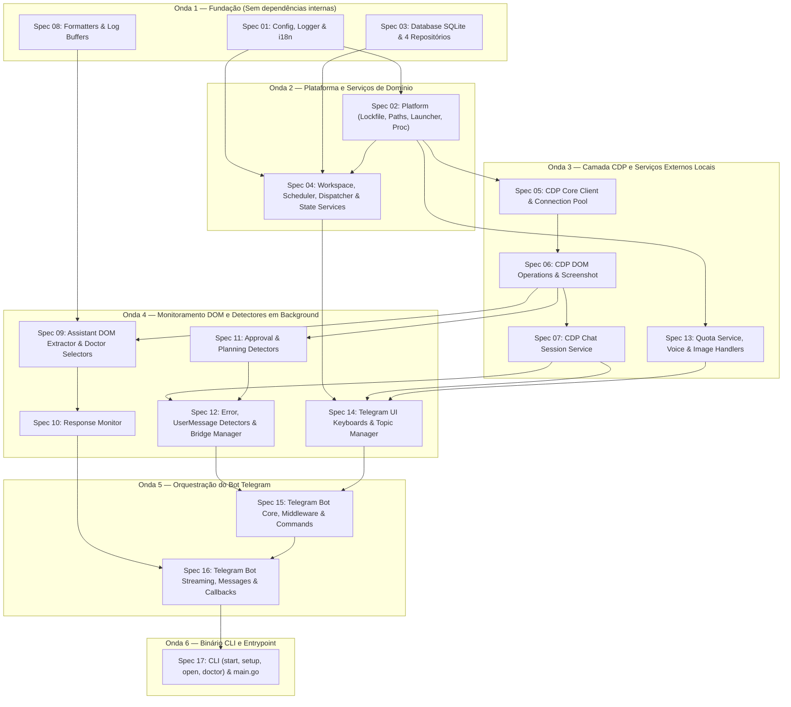

# 00 — Índice Mestre, Grafo de Dependências e Matriz de Rastreabilidade (`raw-specs`)

## 1. Propósito deste Diretório (`raw-specs/`)

Este diretório contém as **17 especificações técnicas modulares e autocontidas** (`01` a `17`) para o porte completo do **Antigravity Telegram Remote** de TypeScript/Node.js para **Golang (1.23+)**, derivadas da auditoria linha a linha de:
- **9 documentos arquiteturais** em [`antigravity-telegram-remote-golang/docs/`](file:///Users/vinicius.canedo/Documents/trae_projects/antigravity-telegram-remote/antigravity-telegram-remote-golang/docs);
- **68 arquivos de código-fonte original** em [`src/`](file:///Users/vinicius.canedo/Documents/trae_projects/antigravity-telegram-remote/src) (`13.876` linhas);
- **3 dicionários de internacionalização** em [`locales/`](file:///Users/vinicius.canedo/Documents/trae_projects/antigravity-telegram-remote/locales) (`en.json`, `ja.json`, `vi.json`);
- **71 arquivos de testes unitários originais** em [`tests/`](file:///Users/vinicius.canedo/Documents/trae_projects/antigravity-telegram-remote/tests) (`12.287` linhas).

O objetivo desta decomposição é permitir que cada módulo seja implementado e testado em Go **de forma isolada, incremental e verificável**, sem necessidade de carregar todo o código-fonte original no contexto de uma única tarefa.

---

## 2. Catálogo das 17 Especificações Técnicas

| Spec | Arquivo em `raw-specs/` | Pacotes Go Alvo | Linhas `src/` | Linhas `tests/` | Resumo do Escopo |
| :---: | :--- | :--- | :---: | :---: | :--- |
| **01** | [`01-config-logger-and-i18n.md`](./01-config-logger-and-i18n.md) | `internal/config` `internal/logger` `internal/i18n` | 380 | 688 | `AppConfig`, merge `.env` + `config.json`, logger ANSI (`[PHASE]`, `[DONE]`, `divider`) e i18n (`en`, `ja`, `vi` via `//go:embed`). |
| **02** | [`02-platform-lockfile-paths-and-launcher.md`](./02-platform-lockfile-paths-and-launcher.md) | `internal/platform` | 245 | 327 | Lockfile `.bot.lock` (`SIGTERM` $\rightarrow$ 5s $\rightarrow$ `SIGKILL`), caminhos multiplataforma, `ensureAntigravityRunning()` e descoberta de processo/portas do `language_server` (`proc_unix.go`, `proc_windows.go`). |
| **03** | [`03-database-sqlite-and-repositories.md`](./03-database-sqlite-and-repositories.md) | `internal/database` | 601 | 566 | SQLite pure-Go (`modernc.org/sqlite`) em modo `WAL` e os 4 repositórios (`chat_sessions`, `workspace_bindings`, `templates`, `schedules`). |
| **04** | [`04-workspace-scheduler-and-state-services.md`](./04-workspace-scheduler-and-state-services.md) | `internal/workspace` `internal/scheduler` `internal/bridge` (parcial) | 796 | 997 | `resolveSafePath` (anti-traversal e anti-symlink bypass), `WorkspaceService`, `ScheduleService` (cron), `ModeService`, `ModelService`, `AutoAcceptService`, `TitleGeneratorService` e `PromptDispatcher` (locks por workspace e canal). |
| **05** | [`05-cdp-core-client-and-connection-pool.md`](./05-cdp-core-client-and-connection-pool.md) | `internal/cdp` (core & pool) | ~975 | 1.072 | `CDP_PORTS`, descoberta HTTP `/json/list`, `discoverWorkspaceTarget`, abertura automática de janela (`launchAndConnectWorkspace`), transporte WebSocket JSON-RPC, contextos V8 (`Runtime.executionContext*`), reconexão exponencial e `CdpConnectionPool`. |
| **06** | [`06-cdp-dom-operations-and-screenshot.md`](./06-cdp-dom-operations-and-screenshot.md) | `internal/cdp` (operations & screenshot) | ~867 | 819 | `injectMessage`, `FOCUS_EDITOR_SCRIPT`, `attachImageFiles` (`data-agclaw-upload-token` + `DOM.setFileInputFiles`), `getCurrentMode`/`setUiMode`, `getUiModels`/`getCurrentModel`/`setUiModel`, `extractLatestResponseImages` e `ScreenshotService`. |
| **07** | [`07-cdp-chat-session-service.md`](./07-cdp-chat-session-service.md) | `internal/cdp/session.go` | 820 | 391 | `ChatSessionService`: `startNewChat` (`Input.dispatchMouseEvent` + verificação de cursor), `getCurrentSessionInfo`, `listAllSessions` (modal Past Conversations até `"Other Conversations"`) e `activateSessionByTitle`. |
| **08** | [`08-formatters-and-log-buffers.md`](./08-formatters-and-log-buffers.md) | `internal/formatter` `internal/monitor` (buffers) | 1.048 | 976 | `htmlToTelegramHtml`, `formatForTelegram`, `splitOutputAndLogs` (`UI_CHROME_*`), `splitTelegramHtml` (`4096` chars com fechamento/reabertura de tags), `streamMessageFormatter`, `metadataExtractor`, `ProcessLogBuffer` (`pickEmoji`) e `ProgressSender`. |
| **09** | [`09-assistant-dom-extractor-and-selectors.md`](./09-assistant-dom-extractor-and-selectors.md) | `internal/monitor/dom_extractor.go` `internal/cli/doctor_selectors.go` | 539 | 392 | `AssistantDomExtractor` (classificação estruturada de segmentos `activity`, `thinking`, `body`, `tool-call`, `tool-result`, `feedback`) e diagnóstico `doctorSelector` (`Score: X/7 Healthy`). |
| **10** | [`10-response-monitor.md`](./10-response-monitor.md) | `internal/monitor/response_monitor.go` | 1.206 | 2.361 | Máquina de estados `ResponseMonitor` (`start`, `startPassive`, `pollIntervalMs = 2000`, `stopGoneConfirmCount = 3`, `consecutiveWsErrors >= 5`, `clickStopButton`, `detectQuotaError` / `EXTRACT_QUOTA_ERROR_SCRIPT`). |
| **11** | [`11-approval-and-planning-detectors.md`](./11-approval-and-planning-detectors.md) | `internal/bridge` (detectors I) | 781 | 1.052 | `ApprovalDetector` (`Allow`, `Allow This Conversation`, `Deny`, dropdown chevron) e `PlanningDetector` (`Open`, `Proceed`, cooldown 5s e `extractPlanContent`). |
| **12** | [`12-error-usermessage-detectors-and-bridge.md`](./12-error-usermessage-detectors-and-bridge.md) | `internal/bridge` (detectors II & manager) | 991 | 1.037 | `ErrorPopupDetector` (`Dismiss`, `Copy debug info` + `readClipboard`, `Retry`, cooldown 10s), `UserMessageDetector` (priming, SHA-256 anti-eco 60s) e `CdpBridgeManager` (roteamento por sessão/workspace, auto-accept e callbacks). |
| **13** | [`13-quota-voice-and-image-handlers.md`](./13-quota-voice-and-image-handlers.md) | `internal/quota` `internal/voice` `internal/bot/image_handler.go` | 481 | 265 | `QuotaService` (HTTPS local `GetUserStatus` com header `X-Codeium-Csrf-Token` e cache), `voiceHandler` (`whisper-cli` + `ffmpeg`, modelo `base.en`) e `imageHandler` (download/limpeza em `/tmp`, Data URLs e fallback de URLs). |
| **14** | [`14-telegram-ui-keyboards-and-topic-manager.md`](./14-telegram-ui-keyboards-and-topic-manager.md) | `internal/bot/ui` `internal/bot/topic_manager.go` | 693 | 683 | Todos os 8 construtores de teclados inline (`autoAcceptUi`, `modeUi`, `modelsUi`, `planUi`, `projectListUi`, `screenshotUi`, `sessionPickerUi`, `templateUi`) e `TelegramTopicManager` (`createForumTopic`, `editForumTopic`, `closeForumTopic`, `deleteForumTopic`). |
| **15** | [`15-telegram-bot-core-middleware-and-commands.md`](./15-telegram-bot-core-middleware-and-commands.md) | `internal/bot` (core & commands) | ~1.130 | 345 | Inicialização `startBot`, listeners de desconexão/reconexão do pool, middleware `allowedUserIds`, parser `parseMessageContent`, handlers auxiliares (`src/commands/*.ts`) e os 16 comandos registrados + `/join` (ADR-005) + `setMyCommands`. |
| **16** | [`16-telegram-bot-streaming-messages-and-callbacks.md`](./16-telegram-bot-streaming-messages-and-callbacks.md) | `internal/bot` (streaming & callbacks) | ~1.138 | — | `sendPromptToAntigravity` (ciclo completo de streaming, timer de 5s, `<blockquote expandable>`, imagens geradas, auto-rename de tópico, seletor de modelos em erro de cota), espelhamento PC $\rightarrow$ Telegram (`startPassive`), roteador `callback_query:data` e handlers `message:text`/`photo`/`voice`. |
| **17** | [`17-cli-commands-and-entrypoint.md`](./17-cli-commands-and-entrypoint.md) | `cmd/antigravity-bot` `internal/cli` | 903 | 276 | Entrypoint `main.go`, CLI Cobra (`start`, `setup` interativo em 3 passos com máscara `*` e autocomplete `Tab`, `open`, `doctor` em 7 passos), `printWelcome`, `LOGO` e `UpdateCheckService` (cache 24h). |

---

## 3. Grafo de Dependências (DAG) e Ondas de Implementação

### Estratégia de Execução Paralela por Ondas
1. **Onda 1 (`Specs 01, 03, 08`)**: Podem ser implementadas e testadas 100% em paralelo. Não dependem de CDP nem do Telegram.
2. **Onda 2 (`Specs 02, 04`)**: `Spec 02` depende apenas de `Spec 01`; `Spec 04` depende de `Specs 01, 02, 03`.
3. **Onda 3 (`Specs 05, 06, 07, 13`)**: Implementa toda a comunicação WebSocket CDP, operações DOM, gerenciamento de sessões de chat e serviços locais (`QuotaService`, `voice`, `imageHandler`).
4. **Onda 4 (`Specs 09, 10, 11, 12, 14`)**: Implementa o extrator estruturado do DOM, a máquina de estados `ResponseMonitor`, os 4 detectores em background, o `CdpBridgeManager` e os 8 pacotes de UI inline do Telegram.
5. **Onda 5 (`Specs 15, 16`)**: Conecta comandos, middlewares, streaming em tempo real e callbacks no pacote `internal/bot`.
6. **Onda 6 (`Spec 17`)**: Expõe os subcomandos da CLI (`start`, `setup`, `open`, `doctor`) e o entrypoint `cmd/antigravity-bot/main.go`.

---

## 4. Convenções Globais de Engenharia para o Port Go

1. **Versão da Linguagem e Módulo (`go.mod`)**:
   - Module path sugerido: `github.com/antigravity-dev/antigravity-telegram-remote` (ou `antigravity-telegram-remote-golang`).
   - Go `1.23+`, compilação 100% sem CGO (`CGO_ENABLED=0`).
2. **Dependências Externas Padronizadas**:
   - `github.com/go-telegram/bot`: cliente Bot API do Telegram.
   - `github.com/coder/websocket`: cliente WebSocket para o Chrome DevTools Protocol (CDP).
   - `modernc.org/sqlite` + `database/sql`: driver SQLite Pure-Go em modo WAL.
   - `github.com/spf13/cobra`: CLI e subcomandos.
   - `golang.org/x/term`: leitura de senha mascarada (`askSecret`) e modo raw do terminal no `setup`.
   - `github.com/robfig/cron/v3`: agendador de tarefas recorrentes (`ScheduleService`).
   - `github.com/joho/godotenv`: leitura de `.env`.
3. **Interfaces para Desacoplamento e Testabilidade**:
   - Cada pacote que consome CDP (`monitor`, `bridge`, `ui`, `bot`) recebe uma interface (ex.: `CDPClient` / `CDPRuntimeEvaluator`) em vez de depender diretamente de uma conexão TCP/WebSocket aberta, permitindo traduzir 100% dos mocks de Jest (`jest.fn()`) dos 71 arquivos em `tests/` para mocks/fakes leves em Go (`*_test.go`).
4. **Fidelidade Estrita aos Seletores DOM, Scripts JS e Contratos**:
   - Todos os scripts JavaScript avaliados via `Runtime.evaluate` devem ser mantidos como constantes `string` (raw string literals `` `...` ``) idênticas às do código TypeScript original, pois operam diretamente sobre a árvore DOM real do Electron/Antigravity.

---

## 5. Matriz de Rastreabilidade Completa — Código-Fonte (`src/` — 68 Arquivos)

| # | Arquivo Original (`src/`) | Linhas | Pacote / Arquivo Go | Spec em `raw-specs/` |
| :- | :--- | :---: | :--- | :--- |
| 1 | `src/index.ts` | 11 | `cmd/antigravity-bot/main.go` | [Spec 17](./17-cli-commands-and-entrypoint.md) |
| 2 | `src/bin/cli.ts` | 54 | `internal/cli/root.go` | [Spec 17](./17-cli-commands-and-entrypoint.md) |
| 3 | `src/bin/welcome.ts` | 53 | `internal/cli/welcome.go` | [Spec 17](./17-cli-commands-and-entrypoint.md) |
| 4 | `src/bin/commands/doctor.ts` | 178 | `internal/cli/doctor.go` | [Spec 17](./17-cli-commands-and-entrypoint.md) |
| 5 | `src/bin/commands/open.ts` | 157 | `internal/cli/open.go` | [Spec 17](./17-cli-commands-and-entrypoint.md) |
| 6 | `src/bin/commands/setup.ts` | 281 | `internal/cli/setup.go` | [Spec 17](./17-cli-commands-and-entrypoint.md) |
| 7 | `src/bin/commands/start.ts` | 42 | `internal/cli/start.go` | [Spec 17](./17-cli-commands-and-entrypoint.md) |
| 8 | `src/bot/index.ts` | 1938 | `internal/bot/bot.go`, `handlers_*.go`, `streaming.go`, `callbacks.go` | [Spec 15](./15-telegram-bot-core-middleware-and-commands.md), [Spec 16](./16-telegram-bot-streaming-messages-and-callbacks.md) |
| 9 | `src/commands/chatCommandHandler.ts` | 40 | `internal/bot/handlers_chat.go` | [Spec 15](./15-telegram-bot-core-middleware-and-commands.md) |
| 10 | `src/commands/cleanupCommandHandler.ts` | 53 | `internal/bot/handlers_cleanup.go` | [Spec 15](./15-telegram-bot-core-middleware-and-commands.md) |
| 11 | `src/commands/joinCommandHandler.ts` | 36 | `internal/bot/handlers_session.go` | [Spec 15](./15-telegram-bot-core-middleware-and-commands.md) |
| 12 | `src/commands/messageParser.ts` | 37 | `internal/bot/message_parser.go` | [Spec 15](./15-telegram-bot-core-middleware-and-commands.md) |
| 13 | `src/commands/slashCommandHandler.ts` | 123 | `internal/bot/handlers_template.go` | [Spec 15](./15-telegram-bot-core-middleware-and-commands.md) |
| 14 | `src/commands/workspaceCommandHandler.ts` | 32 | `internal/bot/handlers_project.go` | [Spec 15](./15-telegram-bot-core-middleware-and-commands.md) |
| 15 | `src/database/chatSessionRepository.ts` | 164 | `internal/database/session_repo.go` | [Spec 03](./03-database-sqlite-and-repositories.md) |
| 16 | `src/database/scheduleRepository.ts` | 169 | `internal/database/schedule_repo.go` | [Spec 03](./03-database-sqlite-and-repositories.md) |
| 17 | `src/database/templateRepository.ts` | 131 | `internal/database/template_repo.go` | [Spec 03](./03-database-sqlite-and-repositories.md) |
| 18 | `src/database/workspaceBindingRepository.ts` | 137 | `internal/database/binding_repo.go` | [Spec 03](./03-database-sqlite-and-repositories.md) |
| 19 | `src/middleware/auth.ts` | 9 | `internal/bot/middleware.go` | [Spec 15](./15-telegram-bot-core-middleware-and-commands.md) |
| 20 | `src/middleware/sanitize.ts` | 34 | `internal/workspace/sanitize.go` | [Spec 04](./04-workspace-scheduler-and-state-services.md) |
| 21 | `src/services/antigravityLauncher.ts` | 60 | `internal/platform/launcher.go` | [Spec 02](./02-platform-lockfile-paths-and-launcher.md) |
| 22 | `src/services/approvalDetector.ts` | 428 | `internal/bridge/approval_detector.go` | [Spec 11](./11-approval-and-planning-detectors.md) |
| 23 | `src/services/assistantDomExtractor.ts` | 444 | `internal/monitor/dom_extractor.go` | [Spec 09](./09-assistant-dom-extractor-and-selectors.md) |
| 24 | `src/services/autoAcceptService.ts` | 94 | `internal/bridge/auto_accept.go` | [Spec 04](./04-workspace-scheduler-and-state-services.md) |
| 25 | `src/services/cdpBridgeManager.ts` | 439 | `internal/bridge/manager.go` | [Spec 12](./12-error-usermessage-detectors-and-bridge.md) |
| 26 | `src/services/cdpConnectionPool.ts` | 283 | `internal/cdp/pool.go` | [Spec 05](./05-cdp-core-client-and-connection-pool.md) |
| 27 | `src/services/cdpService.ts` | 1712 | `internal/cdp/client.go`, `operations.go` | [Spec 05](./05-cdp-core-client-and-connection-pool.md), [Spec 06](./06-cdp-dom-operations-and-screenshot.md) |
| 28 | `src/services/chatSessionService.ts` | 820 | `internal/cdp/session.go` | [Spec 07](./07-cdp-chat-session-service.md) |
| 29 | `src/services/errorPopupDetector.ts` | 303 | `internal/bridge/error_detector.go` | [Spec 12](./12-error-usermessage-detectors-and-bridge.md) |
| 30 | `src/services/modeService.ts` | 94 | `internal/bridge/mode_service.go` | [Spec 04](./04-workspace-scheduler-and-state-services.md) |
| 31 | `src/services/modelService.ts` | 78 | `internal/bridge/model_service.go` | [Spec 04](./04-workspace-scheduler-and-state-services.md) |
| 32 | `src/services/planningDetector.ts` | 353 | `internal/bridge/planning_detector.go` | [Spec 11](./11-approval-and-planning-detectors.md) |
| 33 | `src/services/processManager.ts` | 78 | *(Legado omitido no binário Go — ADR-006)* | [Spec 04](./04-workspace-scheduler-and-state-services.md) |
| 34 | `src/services/progressSender.ts` | 77 | `internal/monitor/progress_sender.go` | [Spec 08](./08-formatters-and-log-buffers.md) |
| 35 | `src/services/promptDispatcher.ts` | 91 | `internal/bridge/dispatcher.go` | [Spec 04](./04-workspace-scheduler-and-state-services.md) |
| 36 | `src/services/quotaService.ts` | 175 | `internal/quota/service.go`, `internal/platform/proc_*.go` | [Spec 02](./02-platform-lockfile-paths-and-launcher.md), [Spec 13](./13-quota-voice-and-image-handlers.md) |
| 37 | `src/services/responseMonitor.ts` | 1206 | `internal/monitor/response_monitor.go` | [Spec 10](./10-response-monitor.md) |
| 38 | `src/services/scheduleService.ts` | 127 | `internal/scheduler/service.go` | [Spec 04](./04-workspace-scheduler-and-state-services.md) |
| 39 | `src/services/screenshotService.ts` | 128 | `internal/cdp/screenshot.go` | [Spec 06](./06-cdp-dom-operations-and-screenshot.md) |
| 40 | `src/services/telegramTopicManager.ts` | 112 | `internal/bot/topic_manager.go` | [Spec 14](./14-telegram-ui-keyboards-and-topic-manager.md) |
| 41 | `src/services/titleGeneratorService.ts` | 119 | `internal/bridge/title_generator.go` | [Spec 04](./04-workspace-scheduler-and-state-services.md) |
| 42 | `src/services/updateCheckService.ts` | 118 | `internal/cli/update_check.go` | [Spec 17](./17-cli-commands-and-entrypoint.md) |
| 43 | `src/services/userMessageDetector.ts` | 249 | `internal/bridge/user_message_detector.go` | [Spec 12](./12-error-usermessage-detectors-and-bridge.md) |
| 44 | `src/services/workspaceService.ts` | 80 | `internal/workspace/service.go` | [Spec 04](./04-workspace-scheduler-and-state-services.md) |
| 45 | `src/tools/doctorSelector.ts` | 95 | `internal/cli/doctor_selectors.go` | [Spec 09](./09-assistant-dom-extractor-and-selectors.md) |
| 46 | `src/ui/autoAcceptUi.ts` | 27 | `internal/bot/ui/autoaccept_ui.go` | [Spec 14](./14-telegram-ui-keyboards-and-topic-manager.md) |
| 47 | `src/ui/modeUi.ts` | 65 | `internal/bot/ui/mode_ui.go` | [Spec 14](./14-telegram-ui-keyboards-and-topic-manager.md) |
| 48 | `src/ui/modelsUi.ts` | 120 | `internal/bot/ui/models_ui.go` | [Spec 14](./14-telegram-ui-keyboards-and-topic-manager.md) |
| 49 | `src/ui/planUi.ts` | 177 | `internal/bot/ui/plan_ui.go` | [Spec 14](./14-telegram-ui-keyboards-and-topic-manager.md) |
| 50 | `src/ui/projectListUi.ts` | 71 | `internal/bot/ui/project_ui.go` | [Spec 14](./14-telegram-ui-keyboards-and-topic-manager.md) |
| 51 | `src/ui/screenshotUi.ts` | 29 | `internal/bot/ui/screenshot_ui.go` | [Spec 14](./14-telegram-ui-keyboards-and-topic-manager.md) |
| 52 | `src/ui/sessionPickerUi.ts` | 37 | `internal/bot/ui/session_ui.go` | [Spec 14](./14-telegram-ui-keyboards-and-topic-manager.md) |
| 53 | `src/ui/templateUi.ts` | 55 | `internal/bot/ui/template_ui.go` | [Spec 14](./14-telegram-ui-keyboards-and-topic-manager.md) |
| 54 | `src/utils/cdpPorts.ts` | 2 | `internal/cdp/ports.go` | [Spec 05](./05-cdp-core-client-and-connection-pool.md) |
| 55 | `src/utils/config.ts` | 24 | `internal/config/config.go` | [Spec 01](./01-config-logger-and-i18n.md) |
| 56 | `src/utils/configLoader.ts` | 203 | `internal/config/loader.go` | [Spec 01](./01-config-logger-and-i18n.md) |
| 57 | `src/utils/htmlToTelegramMarkdown.ts` | 275 | `internal/formatter/html_converter.go` | [Spec 08](./08-formatters-and-log-buffers.md) |
| 58 | `src/utils/i18n.ts` | 54 | `internal/i18n/i18n.go` | [Spec 01](./01-config-logger-and-i18n.md) |
| 59 | `src/utils/imageHandler.ts` | 141 | `internal/bot/image_handler.go` | [Spec 13](./13-quota-voice-and-image-handlers.md) |
| 60 | `src/utils/lockfile.ts` | 115 | `internal/platform/lockfile.go` | [Spec 02](./02-platform-lockfile-paths-and-launcher.md) |
| 61 | `src/utils/logger.ts` | 99 | `internal/logger/logger.go` | [Spec 01](./01-config-logger-and-i18n.md) |
| 62 | `src/utils/logo.ts` | 9 | `internal/cli/logo.go` | [Spec 17](./17-cli-commands-and-entrypoint.md) |
| 63 | `src/utils/metadataExtractor.ts` | 20 | `internal/formatter/metadata.go` | [Spec 08](./08-formatters-and-log-buffers.md) |
| 64 | `src/utils/pathUtils.ts` | 70 | `internal/platform/paths.go` | [Spec 02](./02-platform-lockfile-paths-and-launcher.md) |
| 65 | `src/utils/processLogBuffer.ts` | 114 | `internal/monitor/process_log_buffer.go` | [Spec 08](./08-formatters-and-log-buffers.md) |
| 66 | `src/utils/streamMessageFormatter.ts` | 94 | `internal/formatter/stream_formatter.go` | [Spec 08](./08-formatters-and-log-buffers.md) |
| 67 | `src/utils/telegramFormatter.ts` | 468 | `internal/formatter/telegram_formatter.go` | [Spec 08](./08-formatters-and-log-buffers.md) |
| 68 | `src/utils/voiceHandler.ts` | 165 | `internal/voice/transcriber.go` | [Spec 13](./13-quota-voice-and-image-handlers.md) |

---

## 6. Matriz de Rastreabilidade Completa — Testes Unitários (`tests/` — 71 Arquivos)

| # | Arquivo de Teste Original (`tests/`) | Linhas | Arquivo de Teste Go (`*_test.go`) | Spec em `raw-specs/` |
| :- | :--- | :---: | :--- | :--- |
| 1 | `tests/config.test.ts` | 98 | `internal/config/config_test.go` | [Spec 01](./01-config-logger-and-i18n.md) |
| 2 | `tests/utils/config.test.ts` | 9 | `internal/config/config_test.go` | [Spec 01](./01-config-logger-and-i18n.md) |
| 3 | `tests/utils/configLoader.test.ts` | 247 | `internal/config/loader_test.go` | [Spec 01](./01-config-logger-and-i18n.md) |
| 4 | `tests/utils/logger.test.ts` | 249 | `internal/logger/logger_test.go` | [Spec 01](./01-config-logger-and-i18n.md) |
| 5 | `tests/utils/i18n.test.ts` | 85 | `internal/i18n/i18n_test.go` | [Spec 01](./01-config-logger-and-i18n.md) |
| 6 | `tests/utils/lockfile.test.ts` | 142 | `internal/platform/lockfile_test.go` | [Spec 02](./02-platform-lockfile-paths-and-launcher.md) |
| 7 | `tests/utils/pathUtils.test.ts` | 86 | `internal/platform/paths_test.go` | [Spec 02](./02-platform-lockfile-paths-and-launcher.md) |
| 8 | `tests/services/antigravityLauncher.test.ts` | 99 | `internal/platform/launcher_test.go` | [Spec 02](./02-platform-lockfile-paths-and-launcher.md) |
| 9 | `tests/database/chatSessionRepository.test.ts` | 129 | `internal/database/session_repo_test.go` | [Spec 03](./03-database-sqlite-and-repositories.md) |
| 10 | `tests/database/workspaceBindingRepository.test.ts` | 128 | `internal/database/binding_repo_test.go` | [Spec 03](./03-database-sqlite-and-repositories.md) |
| 11 | `tests/database/templateRepository.test.ts` | 111 | `internal/database/template_repo_test.go` | [Spec 03](./03-database-sqlite-and-repositories.md) |
| 12 | `tests/database/scheduleRepository.test.ts` | 198 | `internal/database/schedule_repo_test.go` | [Spec 03](./03-database-sqlite-and-repositories.md) |
| 13 | `tests/middleware/sanitize.test.ts` | 34 | `internal/workspace/sanitize_test.go` | [Spec 04](./04-workspace-scheduler-and-state-services.md) |
| 14 | `tests/middleware/sanitize.bugfix.test.ts` | 52 | `internal/workspace/sanitize_test.go` | [Spec 04](./04-workspace-scheduler-and-state-services.md) |
| 15 | `tests/services/workspaceService.test.ts` | 109 | `internal/workspace/service_test.go` | [Spec 04](./04-workspace-scheduler-and-state-services.md) |
| 16 | `tests/services/scheduleService.test.ts` | 237 | `internal/scheduler/service_test.go` | [Spec 04](./04-workspace-scheduler-and-state-services.md) |
| 17 | `tests/services/modeService.test.ts` | 57 | `internal/bridge/mode_service_test.go` | [Spec 04](./04-workspace-scheduler-and-state-services.md) |
| 18 | `tests/services/modelService.test.ts` | 82 | `internal/bridge/model_service_test.go` | [Spec 04](./04-workspace-scheduler-and-state-services.md) |
| 19 | `tests/services/autoAcceptService.test.ts` | 49 | `internal/bridge/auto_accept_test.go` | [Spec 04](./04-workspace-scheduler-and-state-services.md) |
| 20 | `tests/services/titleGeneratorService.test.ts` | 104 | `internal/bridge/title_generator_test.go` | [Spec 04](./04-workspace-scheduler-and-state-services.md) |
| 21 | `tests/services/promptDispatcher.test.ts` | 34 | `internal/bridge/dispatcher_test.go` | [Spec 04](./04-workspace-scheduler-and-state-services.md) |
| 22 | `tests/services/promptDispatcher.concurrency.test.ts` | 128 | `internal/bridge/dispatcher_test.go` | [Spec 04](./04-workspace-scheduler-and-state-services.md) |
| 23 | `tests/services/processManager.test.ts` | 151 | *(Omitido conforme ADR-006)* | [Spec 04](./04-workspace-scheduler-and-state-services.md) |
| 24 | `tests/services/cdpService.test.ts` | 125 | `internal/cdp/client_test.go` | [Spec 05](./05-cdp-core-client-and-connection-pool.md) |
| 25 | `tests/services/cdpService.workspace.test.ts` | 285 | `internal/cdp/client_test.go` | [Spec 05](./05-cdp-core-client-and-connection-pool.md) |
| 26 | `tests/services/cdpService.errorHandling.test.ts` | 223 | `internal/cdp/client_test.go` | [Spec 05](./05-cdp-core-client-and-connection-pool.md) |
| 27 | `tests/services/cdpService.security.test.ts` | 11 | `internal/cdp/client_test.go` | [Spec 05](./05-cdp-core-client-and-connection-pool.md) |
| 28 | `tests/services/cdpConnectionPool.test.ts` | 283 | `internal/cdp/pool_test.go` | [Spec 05](./05-cdp-core-client-and-connection-pool.md) |
| 29 | `tests/services/cdpConnectionPool.bugfix.test.ts` | 145 | `internal/cdp/pool_test.go` | [Spec 05](./05-cdp-core-client-and-connection-pool.md) |
| 30 | `tests/services/cdpService.injection.test.ts` | 221 | `internal/cdp/operations_test.go` | [Spec 06](./06-cdp-dom-operations-and-screenshot.md) |
| 31 | `tests/services/cdpService.imageTransfer.test.ts` | 206 | `internal/cdp/operations_test.go` | [Spec 06](./06-cdp-dom-operations-and-screenshot.md) |
| 32 | `tests/services/cdpService.uiSync.test.ts` | 255 | `internal/cdp/operations_test.go` | [Spec 06](./06-cdp-dom-operations-and-screenshot.md) |
| 33 | `tests/services/screenshotService.test.ts` | 137 | `internal/cdp/screenshot_test.go` | [Spec 06](./06-cdp-dom-operations-and-screenshot.md) |
| 34 | `tests/services/chatSessionService.test.ts` | 391 | `internal/cdp/session_test.go` | [Spec 07](./07-cdp-chat-session-service.md) |
| 35 | `tests/utils/htmlToTelegramMarkdown.test.ts` | 238 | `internal/formatter/html_converter_test.go` | [Spec 08](./08-formatters-and-log-buffers.md) |
| 36 | `tests/utils/telegramFormatter.test.ts` | 208 | `internal/formatter/telegram_formatter_test.go` | [Spec 08](./08-formatters-and-log-buffers.md) |
| 37 | `tests/utils/splitTelegramHtml.test.ts` | 119 | `internal/formatter/telegram_formatter_test.go` | [Spec 08](./08-formatters-and-log-buffers.md) |
| 38 | `tests/utils/streamMessageFormatter.test.ts` | 83 | `internal/formatter/stream_formatter_test.go` | [Spec 08](./08-formatters-and-log-buffers.md) |
| 39 | `tests/utils/metadataExtractor.test.ts` | 38 | `internal/formatter/metadata_test.go` | [Spec 08](./08-formatters-and-log-buffers.md) |
| 40 | `tests/utils/processLogBuffer.test.ts` | 75 | `internal/monitor/process_log_buffer_test.go` | [Spec 08](./08-formatters-and-log-buffers.md) |
| 41 | `tests/services/progressSender.test.ts` | 88 | `internal/monitor/progress_sender_test.go` | [Spec 08](./08-formatters-and-log-buffers.md) |
| 42 | `tests/services/progressSender.bugfix.test.ts` | 127 | `internal/monitor/progress_sender_test.go` | [Spec 08](./08-formatters-and-log-buffers.md) |
| 43 | `tests/services/assistantDomExtractor.test.ts` | 392 | `internal/monitor/dom_extractor_test.go` | [Spec 09](./09-assistant-dom-extractor-and-selectors.md) |
| 44 | `tests/services/responseMonitor.test.ts` | 1251 | `internal/monitor/response_monitor_test.go` | [Spec 10](./10-response-monitor.md) |
| 45 | `tests/services/responseMonitor.lean.test.ts` | 523 | `internal/monitor/response_monitor_test.go` | [Spec 10](./10-response-monitor.md) |
| 46 | `tests/services/responseMonitor.selectors.test.ts` | 258 | `internal/monitor/response_monitor_test.go` | [Spec 10](./10-response-monitor.md) |
| 47 | `tests/services/responseMonitor.stopButtonSelector.test.ts` | 329 | `internal/monitor/response_monitor_test.go` | [Spec 10](./10-response-monitor.md) |
| 48 | `tests/services/approvalDetector.test.ts` | 480 | `internal/bridge/approval_detector_test.go` | [Spec 11](./11-approval-and-planning-detectors.md) |
| 49 | `tests/services/planningDetector.test.ts` | 572 | `internal/bridge/planning_detector_test.go` | [Spec 11](./11-approval-and-planning-detectors.md) |
| 50 | `tests/services/errorPopupDetector.test.ts` | 571 | `internal/bridge/error_detector_test.go` | [Spec 12](./12-error-usermessage-detectors-and-bridge.md) |
| 51 | `tests/services/userMessageDetector.test.ts` | 359 | `internal/bridge/user_message_detector_test.go` | [Spec 12](./12-error-usermessage-detectors-and-bridge.md) |
| 52 | `tests/services/cdpBridgeManager.test.ts` | 107 | `internal/bridge/manager_test.go` | [Spec 12](./12-error-usermessage-detectors-and-bridge.md) |
| 53 | `tests/services/quotaService.test.ts` | 120 | `internal/quota/service_test.go` | [Spec 13](./13-quota-voice-and-image-handlers.md) |
| 54 | `tests/utils/voiceHandler.test.ts` | 114 | `internal/voice/transcriber_test.go` | [Spec 13](./13-quota-voice-and-image-handlers.md) |
| 55 | `tests/utils/imageHandler.test.ts` | 31 | `internal/bot/image_handler_test.go` | [Spec 13](./13-quota-voice-and-image-handlers.md) |
| 56 | `tests/ui/autoAcceptUi.test.ts` | 33 | `internal/bot/ui/autoaccept_ui_test.go` | [Spec 14](./14-telegram-ui-keyboards-and-topic-manager.md) |
| 57 | `tests/ui/modeUi.test.ts` | 58 | `internal/bot/ui/mode_ui_test.go` | [Spec 14](./14-telegram-ui-keyboards-and-topic-manager.md) |
| 58 | `tests/ui/modelsUi.test.ts` | 143 | `internal/bot/ui/models_ui_test.go` | [Spec 14](./14-telegram-ui-keyboards-and-topic-manager.md) |
| 59 | `tests/ui/planUi.test.ts` | 139 | `internal/bot/ui/plan_ui_test.go` | [Spec 14](./14-telegram-ui-keyboards-and-topic-manager.md) |
| 60 | `tests/ui/projectListUi.test.ts` | 119 | `internal/bot/ui/project_ui_test.go` | [Spec 14](./14-telegram-ui-keyboards-and-topic-manager.md) |
| 61 | `tests/ui/screenshotUi.test.ts` | 58 | `internal/bot/ui/screenshot_ui_test.go` | [Spec 14](./14-telegram-ui-keyboards-and-topic-manager.md) |
| 62 | `tests/ui/sessionPickerUi.test.ts` | 56 | `internal/bot/ui/session_ui_test.go` | [Spec 14](./14-telegram-ui-keyboards-and-topic-manager.md) |
| 63 | `tests/ui/templateUi.test.ts` | 77 | `internal/bot/ui/template_ui_test.go` | [Spec 14](./14-telegram-ui-keyboards-and-topic-manager.md) |
| 64 | `tests/middleware/auth.test.ts` | 21 | `internal/bot/middleware_test.go` | [Spec 15](./15-telegram-bot-core-middleware-and-commands.md) |
| 65 | `tests/commands/messageParser.test.ts` | 43 | `internal/bot/message_parser_test.go` | [Spec 15](./15-telegram-bot-core-middleware-and-commands.md) |
| 66 | `tests/commands/chatCommandHandler.test.ts` | 63 | `internal/bot/handlers_chat_test.go` | [Spec 15](./15-telegram-bot-core-middleware-and-commands.md) |
| 67 | `tests/commands/workspaceCommandHandler.test.ts` | 41 | `internal/bot/handlers_project_test.go` | [Spec 15](./15-telegram-bot-core-middleware-and-commands.md) |
| 68 | `tests/commands/joinCommandHandler.test.ts` | 28 | `internal/bot/handlers_session_test.go` | [Spec 15](./15-telegram-bot-core-middleware-and-commands.md) |
| 69 | `tests/commands/slashCommandHandler.test.ts` | 106 | `internal/bot/handlers_template_test.go` | [Spec 15](./15-telegram-bot-core-middleware-and-commands.md) |
| 70 | `tests/commands/cleanupCommandHandler.test.ts` | 43 | `internal/bot/handlers_cleanup_test.go` | [Spec 15](./15-telegram-bot-core-middleware-and-commands.md) |
| 71 | `tests/services/updateCheckService.test.ts` | 276 | `internal/cli/update_check_test.go` | [Spec 17](./17-cli-commands-and-entrypoint.md) |
